# Lumi AI Companion

> Lumi now speaks and hears in Discord voice channels with correct DAVE
> end-to-end encryption — pure Python, no sidecar — and her local web client
> at `127.0.0.1:5000` is a complete editing surface for persona, models,
> providers, integrations, and settings. Only the external SDK (Phase 8) and
> security hardening (Phase 9) remain on the roadmap.

A local-first, agentic AI companion running on consumer hardware. Lumi is a
persona-driven VTuber-style assistant with real tool use — she can read and
write files, run commands, search the web, control a browser, query her own
memory, verify her own work, track her own behavioral patterns, drive her own
Live2D avatar, and route casual chat through a faster path — all coordinated
through local Ollama.

Unlike scripted chatbots or bracket-tag "tool" syntax, Lumi uses **structured
tool calling** through Ollama's native `/api/chat` tool interface. When she
calls a tool, it actually runs. When she says she did something, you can check
the log and see that she did.

Phase 10 is complete: Lumi now has a full **local web client** at
`127.0.0.1:5000` — a first-run setup wizard, chat, dashboard, memory browser,
persona editor, model manager, cloud provider support (OpenAI, Anthropic,
Gemini, Groq, OpenRouter, and other OpenAI-compatible endpoints), an
integrations page, a settings page with password change and session
management, per-user memory and emotional-state isolation, and voice in the
browser. It's all served locally, so the default setup never leaves your
machine. The terminal remains a first-class developer tool; the two surfaces
share the same state and history.

---

## Table of Contents

- [What She Actually Does](#what-she-actually-does)
  - [Real Agentic Tool Use](#real-agentic-tool-use)
  - [Multi-Step Task Execution](#multi-step-task-execution)
  - [Safety Layers](#safety-layers)
  - [Multi-Model Orchestration](#multi-model-orchestration)
  - [Model Providers & Model Manager](#model-providers--model-manager)
  - [Persona & Voice](#persona--voice)
  - [Episodic Memory](#episodic-memory)
  - [Emotional State & Cognitive Frames](#emotional-state--cognitive-frames)
  - [Self-Model](#self-model)
  - [Autonomous Heartbeat](#autonomous-heartbeat)
  - [Ambient Screen Awareness](#ambient-screen-awareness)
  - [Avatar Control (VTube Studio)](#avatar-control-vtube-studio)
  - [Local Web Client](#local-web-client)
  - [Per-User Isolation](#per-user-isolation)
  - [Multimodal (Optional)](#multimodal-optional)
  - [Diagnostics Dashboard](#diagnostics-dashboard)
  - [Discord Voice](#discord-voice)
  - [Integrations](#integrations)
- [Terminal Commands](#terminal-commands)
- [Web Client](#web-client)
- [Architecture](#architecture)
  - [Turn Flow](#turn-flow)
  - [Architecture Topology](#architecture-topology)
  - [Key Files](#key-files)
  - [Background Modules](#background-modules)
- [Requirements](#requirements)
  - [Recommended Models](#recommended-models)
- [Installation](#installation)
- [Running](#running)
  - [Agent Mode Example](#agent-mode-example)
  - [Avatar Control Example](#avatar-control-example)
  - [Memory Query Example](#memory-query-example)
  - [Memory Backfill](#memory-backfill)
  - [Self-Model Query Example](#self-model-query-example)
  - [Model Routing Query Example](#model-routing-query-example)
- [Voice Customization](#voice-customization)
- [Resource Optimization](#resource-optimization)
- [Known Limitations](#known-limitations)
- [Roadmap](#roadmap)
- [Credits](#credits)
- [Disclaimer](#disclaimer)

---

## What She Actually Does

### Real Agentic Tool Use

Lumi has eleven tools available at request time. She picks them herself based
on the task, executes them one at a time, reads the result, and decides what
to do next — up to `MAX_AGENT_STEPS = 6` per turn.

| Tool | Purpose |
|---|---|
| `read_file(path)` | Read a file inside `WORKSPACE_ROOT` |
| `write_file(path, content)` | Create/overwrite — **requires confirmation** |
| `list_dir(path)` | List a folder |
| `search_files(query, path)` | grep the workspace |
| `run_command(command)` | Run a shell command, capture stdout/stderr — **requires confirmation** |
| `run_in_terminal(command)` | Open a NEW visible terminal — **requires confirmation** |
| `web_search(query)` | Web search or live weather/time |
| `browse_url(url)` | Playwright-based browser navigation |
| `recall_memory(query, since)` | Query Lumi's own long-term memory for facts, past conversations, or events with timestamps |
| `vtube_set_expression(name, enabled)` | Turn an appearance toggle on her own VTube Studio avatar on/off — idempotent |
| `vtube_move(location)` | Move her avatar to a preset screen position |

Because `write_file`, `run_command`, and `run_in_terminal` are gated behind a
`y/n` prompt, nothing destructive ever runs without your explicit approval.
`ConsoleInput` yields stdin during the confirmation prompt (via
`signals.input_paused`) so the terminal's own reader doesn't steal the
keystroke.

**Agent mode is a pure toggle.** Off means conversational only — no tools, no
notices, no refusals. On means full agentic loop. There is no in-between
heuristic. Toggle it with `!agent_on` / `!agent_off` in the terminal, or the
agent chip in the web chat.

### Multi-Step Task Execution

Lumi understands dependency ordering. Ask her to *"write a script that divides
10 by 0, run it, and fix the error"* and she will:

1. `write_file` — create the buggy script
2. `run_command` — run it, see the `ZeroDivisionError`
3. `write_file` — produce a fix
4. `run_command` — re-run to verify the fix
5. Report back in character, having actually verified the fix

That's a self-correcting loop, not a single-tool assistant.

### Safety Layers

Multiple guards prevent the model from lying about having done work, writing
files it wasn't asked to write, or looping on the same failed command:

- **Simulated-action detection** — catches "I've updated the file!" prose that
  isn't backed by a real tool call. Also catches state-change narrations like
  "Hat removed." or "Ponytail_r engaged." when the user asked for an avatar
  change
- **Intent-announcement guard** — catches "let me X" / "let's see" / "now
  let's" without an actual tool call
- **Refusal guard** — catches "I can't" and re-prompts with the original request
- **No-tool-call retry** — if step 0 returns prose for a request that clearly
  needs a tool, forces one retry with an explicit "call the tool, don't
  narrate it" nudge. This catches the "create a hello world script" case
  where the model tries to write code inline
- **Read-only query gate** — refuses `write_file` when the user only asked to read
- **No-op write guard** — refuses writes identical to the current file
- **Duplicate-call guard** — skips repeat tool calls; clears the memory after a
  successful `write_file` so verification runs aren't blocked
- **Tool-call format recovery** — Lumi's model emits tool calls in several
  formats (`[tool(arg=val)]`, `[tool{"k":"v"}]`, `[tool "val"]`, `[tool "val" true]`).
  All are recovered by a chain of parsers before dispatch, so a hallucinated
  format still fires the real tool
- **Protected files** — `main.py`, `constants.py`, `.env`, `Modelfile` are
  never overwritable
- **Path sandbox** — every filesystem tool is confined to `WORKSPACE_ROOT`
- **Auto-backup** — every overwrite of an existing file saves a `.bak` first
- **Linux-command blocklist** — rejects `sudo`, `systemctl`, `ls`, `cat`, etc.
  on Windows before the confirm prompt even appears
- **Avatar state validation** — `vtube_set_expression` rejects unknown state
  names before dispatch and returns the valid list, so the model can retry
  with a correct name instead of looping on a hallucinated one

### Multi-Model Orchestration

Lumi runs a two-path architecture to keep casual conversation fast without
sacrificing agent quality. **Both paths use the same model weights**
(`lumi-qwen3`), so Ollama keeps exactly one copy in VRAM — the fast path is
differentiated only by payload shape and context size.

- **Main path** (`lumi-qwen3`, 16K context, `think=true`): agent turns,
  complex queries, multi-step tasks. Full reasoning enabled.
- **Fast path** (same weights, 8K context, `think=false`): short casual chat,
  memory reflection, session summarization. Thinking disabled for latency.

**Routing heuristic** (first match wins):

| Condition | Route |
|---|---|
| Agent mode active | Main |
| Message > 280 chars | Main |
| Complexity markers (`analyze`, `debug`, `step by step`, `why does`, etc.) | Main |
| Time/date questions | Main |
| Everything else | Fast |

The routing label appears in the terminal on every turn — `Thinking
(conversational, fast)` or `Thinking (conversational, full)` — so you can see
which path handled each message. Use `!model` to check the current routing
state.

**Qwen3 thinking mode.** Qwen3 has an internal reasoning scratchpad that's on
by default. It's genuinely useful for complex queries and agent turns — the
model plans before acting. It's pure overhead for casual chat and **actively
breaks structured extraction tasks** because the model spends the entire
`num_predict` budget on reasoning and returns an empty `content` field.

| Task | think flag |
|---|---|
| Fast conversational path | `false` |
| Full conversational path | `true` |
| Agent turns | `true` |
| Memory reflection | `false` |
| Session summary | `false` |
| Self-model reflection | `false` |
| Heartbeat decision | `false` |

This distinction matters. Without `think=false` on the background tasks, the
reflection loop silently returns empty content and no memories ever get
stored. The fix is in `modules/memory.py` and `modules/session_state.py`.

### Model Providers & Model Manager

Lumi is local-first: everything defaults to Ollama. There is also an optional
provider layer for cloud models and a manager for local ones, both with web UI
on the **Models** page.

**Provider abstraction** (`modules/llm_providers.py`)

- Three client classes — `OllamaClient`, `OpenAICompatClient`, and
  `AnthropicClient` — normalize request payloads, responses, and tool calls
  into one shape (`LLMResponse`, `ToolCall`).
- OpenAI-compatible endpoints cover OpenAI, Gemini, Groq, OpenRouter, and
  any other OpenAI-compatible server (Together, vLLM, LM Studio, DeepSeek)
  via a base-URL override.
- `chat_sync(model_spec, messages, ...)` parses provider-prefixed specs such
  as `openai:gpt-4o-mini` or `deepseek:deepseek-chat`. A bare name like
  `lumi-qwen3` still means local Ollama.
- API keys and base URLs are saved to `.env` by an atomic, comment-preserving
  writer (0600 permissions on POSIX) and are always masked (`mask_key`)
  before anything reaches the UI.
- **Every LLM call site goes through `chat_sync`:** the main conversational
  path, agent turns, memory reflection, session summary, self-model
  reflection, and the heartbeat decision. Ollama-only fields (`think`,
  `num_ctx`, `keep_alive`) are dropped for non-Ollama providers, so a cloud
  spec works transparently. Setting `FAST_MODEL_NAME` to something like
  `groq:llama-3.3-70b-versatile` moves all background LLM work to Groq while
  the main path stays on local `lumi-qwen3`.

**Supported providers out of the box**

| Provider | Model spec prefix | Notes |
|---|---|---|
| Ollama | *(bare names)* | Local, no key required |
| OpenAI | `openai:` | |
| Anthropic | `anthropic:` | Claude family |
| Google Gemini | `gemini:` | OpenAI-compatible endpoint |
| Groq | `groq:` | Very fast inference |
| OpenRouter | `openrouter:` | Aggregator — hundreds of models |
| Any OpenAI-compatible | `openai:` + `OPENAI_BASE_URL` | Together, DeepSeek, vLLM, LM Studio, etc. |

Point `FAST_MODEL_NAME` at Groq and background reflection runs on ~300 tok/s
cloud inference while the main path keeps running on local `lumi-qwen3`. Keys
can be set from the Models page (Providers section) or by editing `.env`
directly; see [Installation](#installation) for the variable names.

**Model manager** (`modules/model_manager.py`)

- Talks to Ollama's HTTP API: `/api/tags` (installed), `/api/ps` (loaded),
  `/api/generate` (load/unload), `/api/pull`, `/api/delete`.
- Hot-patches routing in `constants.py` (`MODEL_NAME`, `FAST_MODEL_NAME`,
  `FAST_MODEL_ENABLED`, `FAST_MODEL_NUM_CTX`, `MAIN_NUM_CTX`,
  `FAST_MODEL_KEEP_ALIVE`) with a line-level regex patcher that preserves
  surrounding comments and formatting. Only top-level `NAME = ...` lines are
  touched, the result is `compile()`-checked, and a `.bak` is saved before
  every write.
- `_rebind_consumers` re-points modules that already imported those values
  (`prompter`, `memory`, `session_state`, …) so a routing change applies
  without restarting the process.

**Models page** — a *Loaded now* panel, an *Installed* list (filter,
Load / Unload / Delete, loaded badge), a *Pull* box with a streaming progress
bar, a *Routing* form whose dropdowns list Ollama models plus cloud models
as optgroups once a provider key is saved, and provider cards (masked key,
Configure modal, Test button, "Get key" link).

**HTTP endpoints** (in `modules/socketIO.py`; login-gated, state-changing
routes are CSRF- and origin-checked)

| Endpoint | Purpose |
|---|---|
| `GET /api/models` | Installed and loaded models |
| `GET/POST /api/models/pull` | Pull progress / start a background pull |
| `POST /api/models/load`, `/unload`, `/delete` | Manage local models |
| `PUT /api/models/routing` | Update main / fast routing (hot-patches `constants.py`) |
| `GET /api/providers` | List providers (keys masked) |
| `PUT /api/providers/{pid}` | Save provider config (key + base URL) |
| `POST /api/providers/{pid}/test` | Connectivity check |
| `GET /api/providers/{pid}/models` | Fetch the provider's available models |

> **Privacy note:** pointing a path at a cloud provider sends that path's
> prompts — persona, injected memories, screen context — to that provider.
> The default configuration never leaves your machine.

### Persona & Voice

- **Fish Audio S2** synthesis with inline `[emotion]` tags (`[sarcastic]`,
  `[sighing]`, `[excited]`, `[whispering]`, `[shouting]`, `[laughing]`, …)
  parsed as delivery instructions, not spoken text. Only canonical tags from
  Fish Audio's S2 documentation are used — invented tags like `[smug]` or
  `[deadpan]` are silently ignored by the engine, so the persona prompt
  explicitly bans them. A `_strip_non_canonical_tags()` pass in the TTS
  pipeline removes any invented tags before they reach audio synthesis or
  get echoed back into history.
- **MoodManager** with four profiles: `default`, `bratty`, `brocon`, `soft` —
  switchable at runtime with `set mood <name>`
- **faster-whisper** local STT with VAD-triggered **barge-in** (start talking,
  she stops mid-sentence). Runs on GPU with `float16` for ~0.8–1.2s
  end-to-end latency per utterance.
- **Language mirroring** — if you write or speak in Vietnamese, Spanish,
  Japanese, or another supported language, she replies in that language
- **Dual output routing** — local speakers, Discord voice, or both

### Episodic Memory

ChromaDB-backed long-term memory with **timestamped, importance-scored facts**.

- Every ~10 messages, a background reflection pass asks the LLM to extract
  facts from the recent conversation. Each fact is stored with:
  - `timestamp` (ISO, seconds precision)
  - `importance` (0.0–1.0, model-scored)
  - `valence` (one-word emotion like `frustrated` or `satisfied`, or `null`)
  - `session_id` (per-run, for grouping)
  - `user_id` (the logged-in web user; every read and write is filtered by it)
- Retrieval reweights results by a combined score:
  `0.50 * similarity + 0.30 * importance + 0.20 * recency`, with a 30-day
  half-life on the recency term. Old facts naturally fade; important recent
  ones surface.
- Three query surfaces:
  - `!recall <query>` — terminal command, sorted oldest-first, with
    importance markers (`★` for 0.85+, `·` for 0.6+) and age hints
    (`[6:16 PM]`, `[yesterday]`, `[2d ago]`)
  - `recall_memory(query, since)` — an agent tool Lumi can call on her own
    when you ask "do you remember…" or "when did we talk about…"
  - **Memory page in the web client** — full table, semantic search, edit,
    delete, add, export
- Temporal hints (`yesterday`, `last week`, `3 days ago`) are parsed in both
  the injection path and the explicit query path.
- A migration pass runs on startup and repairs any legacy records with
  missing or malformed metadata. Idempotent — silent when there's nothing
  to fix.
- **Reflection payload passes `think=False`** so Qwen3 writes JSON directly
  to content instead of burning tokens on reasoning. This was a silent
  bug that made reflection appear to succeed while storing zero facts.
- Reflection runs through `chat_sync(FAST_MODEL_NAME, ...)`, so background
  extraction can be offloaded to a cloud provider if you choose.
- **`processed_count` reset uses `>=`** so the counter doesn't stick after
  history hits the 20-message trim cap. Without this, reflection fires twice
  per session and then stops.

### Emotional State & Cognitive Frames

Five runtime variables (`valence`, `arousal`, `frustration`, `curiosity`,
`boredom`) with baselines and exponential decay every 30 seconds. Eight
personality traits from `lumi.yaml` modulate how strongly events move the
state.

Six cognitive frames — `play`, `strategy`, `chaos`, `social`, `learning`,
`threat` — are selected contextually:

- High frustration → `threat`
- Vulnerable user language → `social`
- High arousal + positive valence → `chaos`
- Agent mode active → `strategy`
- High curiosity + low frustration → `learning`
- Default → `play`

Each frame carries a tone directive that gets injected alongside the state
description. The state and frame color her delivery without her ever naming
them.

### Self-Model

Lumi keeps a running model of her own patterns — separate from her memory of
you. Two files, one behavior:

- **Collection** (`modules/self_model.py`): snapshots emotional state every
  60 seconds, tracks per-turn stats (canonical tags used, cognitive frame,
  response length), and increments an unprompted-message count when the
  heartbeat fires.
- **Reflection** (every 10 minutes, minimum 5 turns): sends a structured
  summary of the collected data to the full model and gets back 2–4 short
  observations about recent patterns. Empty list is a valid result.
  Observations are persisted across sessions to `memories/self_model.json`.
- **Injection**: a sparse self-awareness block injected into the prompt only
  when observations are fresh (< 1 hour old). Framed as internal awareness
  the model should not announce.

The reflection model is the full 7B-class model — a smaller variant was tried
first and hallucinated numbers ("an hour" for a 5-minute session, "two
unprompted messages" when the count was 0). The larger model reports
accurately.

Check current state any time with `!self` in the terminal.

### Autonomous Heartbeat

A background loop fires every 30 seconds and decides whether Lumi should speak
without being prompted. Gates:

- Not busy (not thinking or speaking)
- User idle for 5+ minutes (30+ minutes late at night)
- 10+ minutes since her last unprompted message

When gates pass, she's shown the current time, idle duration, last topic,
active window title, current mood, and her recent unprompted messages (to
avoid repeating herself). She responds with either a short anchored message or
the literal token `SILENCE`. When in doubt, she leans toward speaking — a
companion who only talks when something is wrong is not good company.

`_fmt_age()` handles `float('inf')` (fresh session, no user message yet) and
NaN without raising — the earlier overflow bug in the gating logic is fixed.

### Ambient Screen Awareness

A background sampler captures the active screen every 30 seconds, computes an
8×8 average hash, and only calls the vision model (`moondream`) when:

1. The foreground window title changes, or
2. The screen hash changes by more than 14 bits **and** 90+ seconds have
   passed since the last VLM call

Descriptions are cached for 5 minutes. A two-tier injection strategy keeps
casual conversation clean:

- **`[Active window] <title>`** — injected on every turn. Cheap, always
  accurate, no VLM involvement.
- **`[Screen Context] <full description>`** — injected only when the user's
  message matches a screen-reference regex (`screen`, `monitor`, `looking at`,
  `what am I`, `can you see`, etc.).

**Cost profile:** idle on the same window → ~1 screenshot + 1 hash per tick,
no VLM. Active (window switches or big content changes) → one VLM call,
rate-limited to at most once per 90 seconds.

### Avatar Control (VTube Studio)

Lumi drives her own Live2D avatar through pyvts. Two paths exist and both are
wired:

**Passive path** — whenever her reply contains a canonical Fish Audio emotion
tag, the first one is forwarded to the VTS module as an expression trigger.
`[moved]` fires heart eyes, `[angry]` fires the shadow face, `[confused]`
fires spiral eyes. She doesn't have to think about it; her face just matches
what she's already saying.

**Deliberate path** — she has two agent tools and six terminal commands for
manually triggering expressions and moving her avatar.

**Expression state tracking.** Every hotkey on her model is a
`ToggleExpression` — firing the same key twice turns the effect back off.
Some hotkeys are named for the *action* (`remove_jacket`, `hide_ponytail_l`)
rather than the resulting *state* (jacket on, ponytail visible), which reads
backwards. An `EXPRESSION_STATE_MAP` in the VTS module normalizes this:
`vtube_set_expression("jacket", enabled=True)` is a state request, not a
toggle. The module checks its tracked state, fires the hotkey only if the
state needs to change, and no-ops when it's already correct. So "put on your
hat" is idempotent — asking twice doesn't toggle it off the second time.

**Keyboard fallback path.** VTS's `HotkeyTriggerRequest` API is silently
accepted but does not fire on some models' `ToggleExpression` hotkeys (a
gesture-gate quirk in the plugin). The module falls back to simulating the
model's bound key combo (Ctrl+3 for hat, Ctrl+8 for left ponytail, etc.),
focusing the VTS window first. Windows' foreground lock blocks
`SetForegroundWindow` from background processes, so an `AttachThreadInput`
workaround is used. The keypress itself is sequenced (modifier-down, small
sleep, key-tap, small sleep, modifier-up) so VTS's polling input loop catches
every event.

**Natural-language alias resolution.** Lumi sometimes reaches for the
natural word instead of the schema name — `dizzy` instead of `spiral_eyes`,
`shadow` instead of `darkened`, `ponytail_left` instead of `ponytail_l`. A
`_STATE_NAME_ALIASES` map in the prompter resolves these before validation,
so the natural phrasing works.

**Fabrication guard.** On longer requests ("reset everything, take off your
hat, put your jacket on, hide both ponytails, drop the controller..."), Lumi
sometimes narrates success in prose instead of firing each tool call.
Multiple pattern checks catch this and force a retry: completion phrases
("there we go", "all set"), state claims ("Hat removed.", "Ponytail_r
engaged.", "X mode engaged"), meta-claims ("everything reset"), and expression
names wrapped in brackets (`[spiral_eyes]`). When the guard fires she gets one
retry with an explicit "call the tool, don't narrate it" nudge.

**Known gap.** Multi-item requests of more than ~3 items still occasionally
fall through the guard. For batch operations use the terminal commands
(`!set hat off`, `!set jacket on`, etc.) — they're idempotent, always land,
and skip the LLM entirely.

### Local Web Client

A fully offline localhost web application served at `http://127.0.0.1:5000/`
by `modules/socketIO.py`. Plain HTML/CSS/JS — no framework, no build step.
Every setup step that used to mean editing a code file is now a form.

**Pages** (single-page app with `#/chat`, `#/dashboard`, `#/memory`,
`#/persona`, `#/models`, `#/integrations`, `#/settings`):

- **Setup wizard (`/setup`)** — four steps: account → providers →
  integrations → done, with progress dots, `?step=` routing, and skip
  buttons on the optional steps. Reuses the same provider and integration
  modals as the main pages.
- **Login (`/login`)** — dedicated page; register/login toggle in place.
  Argon2id hashes, 30-day sliding session, 5/min/user rate limit,
  `SameSite=Lax` HttpOnly cookie, CSRF double-submit on every state-changing
  request.
- **Chat** — message bubbles with avatars and Fish Audio tag chips, an
  agent-mode toggle chip, a voice playback chip and a hold-to-talk mic chip
  in the status strip. Polls `/api/history` every 1.5s so the log survives
  tab switches. Enter sends, Shift+Enter newline.
- **Dashboard** — stat cards and a live event stream from the log hub
  (`127.0.0.1:5001`), filterable by category.
- **Memory browser** — every stored fact for the current user: star marker,
  age, valence chip, Edit / Delete, semantic search (ChromaDB vector index,
  not substring), sort by newest / oldest / importance, expandable metadata,
  `+ Add memory`, `Export JSON`.
- **Persona editor** — edits `lumi.yaml` with 14 sidebar sections plus a Raw
  YAML tab. Field editors for text, textarea, string lists, object lists,
  key-value maps, and trait sliders. Save / Revert / Reload, and *Preview
  Prompt* renders the system prompt from your draft (with a copy button).
  Uses `ruamel.yaml` to keep comments, key order, and block-scalar styles;
  falls back to PyYAML with a yellow banner if it isn't installed. **Saves
  are live** — the cached system prompt is rebuilt, so the next turn uses the
  new persona with no restart.
- **Models** — model manager and cloud providers (see
  [Model Providers & Model Manager](#model-providers--model-manager)).
- **Integrations** — five cards: Ollama, VTube Studio (with a module-enable
  toggle), Discord, Fish Audio, and Browser. Each has a state pill
  (ok / warn / err / off), a live status message, a Test button, and a
  Configure modal. Keys are masked and written with the same atomic `.env`
  writer as the providers.
- **Settings** — four tabs.
  - *General:* timezone (validated with `zoneinfo`) and Ollama endpoint
    (URL-validated), written through the same `constants.py` line patcher.
  - *Security:* change password, active-sessions table (redacted prefixes,
    "current" badge), per-session Revoke, and sign out other sessions.
  - *Advanced:* Danger Zone with five resets — chat history, session state,
    self-model, events log, and long-term memory (wipes only the current
    user's memories). Confined to a server-side allowlist.
  - *About:* version, Python, platform, workspace, endpoints, models,
    uptime, and loaded modules.

**Voice in the browser.** Two features, both opt-in:

- *TTS playback:* when an utterance starts, `tts.py` hands the audio to
  `socketIO.py`, which sends it over Socket.io (base64 WAV) to every tab that
  has turned on the persistent **Voice: ON/OFF** chip (stored in
  `localStorage`).
- *Mic capture:* the **Hold to talk** chip records with `MediaRecorder`,
  POSTs the webm to `/api/voice_message`, which transcribes with
  `faster-whisper` and injects the text as a user message. It deliberately
  bypasses browser speech APIs so the transcript matches what the server model
  would hear. The first transcription is slow while the model loads.

**Terminal and web share state.** Typing in the terminal appends to the same
`signals.history` the web client polls. Messages sent from the browser go
through the same prompter loop. Agent mode is one shared boolean — flipping
the chip flips terminal behavior, and vice versa.

**Persistence.** Users live in `memories/users.db` (SQLite). Sessions survive
process restarts. Memory facts live in `memories/chroma.db` (ChromaDB).
Per-user emotional snapshots live in `memories/emotional_state/{user_id}.json`.

**Security posture.** Bound to `127.0.0.1` only; CSRF token on every
state-changing request; origin check on the Socket.io handshake and HTTP
POSTs; login rate limiting; the static handler refuses path traversal; the
frontend renders with `textContent`, never `innerHTML`; provider and
integration keys are masked before leaving the server. This is a hardening
pass for a localhost tool, not a full audit — see Known Limitations.

### Per-User Isolation

Logging in as a different web user switches the running `HOST` object and
rebuilds the persona. Two things are isolated per user:

- **Memory** — every fact carries a `user_id`; every query, edit, delete, and
  export filters on it via a ChromaDB `where` clause. A migration pass on
  first run backfills legacy rows.
- **Emotional state** — `EmotionalStateModule` keeps one `EmotionalState` per
  user, persisted every 5 minutes and on shutdown. On login switch the
  outgoing state is saved and the incoming one loaded, and
  `signals.emotional_state` re-points, so every consumer works unchanged.

Session state, the self-model, and the in-memory chat history are **not** yet
per-user. See Known Limitations.

### Multimodal (Optional)

`MultiModal` module captures your primary/secondary monitor on demand, asks a
local VLM (`moondream`) to describe it, and injects the description into the
prompt when she detects a "look at my screen" style question. Triggered by
text patterns, not a continuous loop.

### Diagnostics Dashboard

High-frequency loop output (ambient ticks, heartbeat decisions, memory
operations, history saves, model routing choices, VTS hotkey fires) is routed
to a structured log hub instead of the terminal. Live view at:

```
http://127.0.0.1:5001/
```

Filterable by category (`ambient`, `heartbeat`, `memory`, `emotional`, `mic`,
`discord`, `system`, `self`, `vts`, `tts`), color-coded, auto-refreshing every 2 seconds.
The terminal is reserved for actual conversation, ambient VLM fires, and
unprompted speech.

Events also persist to `logs/events.log` for post-mortem review.

### Discord Voice

Lumi joins Discord voice channels, hears every speaker, knows who's in the
room, and talks back — with Discord's DAVE end-to-end encryption correctly
decrypted in pure Python.

**Why this was hard.** Discord enforces DAVE E2EE on all non-Stage voice
channels (rollout complete 2026-03-02). `discord.py` 2.7+ implements DAVE for
the *send* path only, and `discord-ext-voice-recv` predates enforcement and
has no receive path. Lumi bridges the gap with a `DaveDecryptor` layer that
reads the `DaveSession` `discord.py` already negotiated on the connection,
decrypts each frame with the Python `davey` module (the same Rust
implementation AIRI uses), and feeds the decoded Opus to a per-SSRC decoder
pool before VAD and faster-whisper.

**What it does**

- **Joins automatically.** If `DISCORD_VOICE_CHANNEL_ID` is set, the bot
  joins on boot. Manual `!join` / `!leave` commands are also available.
- **Multi-speaker attribution.** Every utterance is tagged with the speaker's
  display name. If two people talk in the same channel, transcripts stay
  separate and the persona can address them by name.
- **Group-aware persona.** `signals.voice_context` carries the channel
  roster, human count, and mode (`solo` for 1:1, `group` for multiple). The
  prompter injects a `[Discord Voice Context]` block on every turn, and a
  "GROUP AWARENESS" rule in the persona tells her she's in a room, not on a
  call.
- **Roster freshness.** `on_voice_state_update` refreshes the roster whenever
  anyone joins, leaves, or moves in a guild the bot is connected to, so the
  roster never goes stale.
- **RMS VAD with hysteresis.** Speech detection runs at 48 kHz with an RMS
  start threshold of 0.020 and stop threshold of 0.010, so breath sounds and
  background noise don't hold the buffer open. `silence_ms = 500` fires
  transcription half a second after you stop talking, which matches the
  local mic path's feel; `min_speech_ms = 250` filters out stray syllables.
- **Barge-in.** When a user starts talking, Lumi stops mid-sentence — same
  behavior as the local mic path.
- **Clean terminal.** STT transcripts, Discord text messages, and voice
  events route to the log hub dashboard under the `mic` and `discord`
  categories instead of printing to the terminal. The console stays reserved
  for real conversation.
- **Server-mute auto-clear.** If an admin ever muted the bot on the server,
  that state persists across reconnects and silently drops all outgoing
  audio. The client clears it automatically on connect.

**Receive pipeline**

```
Opus (transport-decrypted by the extension)
  → DAVE MLS decrypt (davey.DaveSession.decrypt)
    → Opus decode (one decoder per SSRC)
      → Stereo → mono downmix at 48 kHz
        → RMS VAD with hysteresis
          → buffer until 500 ms silence
            → resample to 16 kHz
              → faster-whisper
```

**Send path:** Fish Audio WAV → FFmpeg → `discord.VoiceClient`.

**Diagnostics** (Discord bot commands)

| Command | Effect |
|---|---|
| `!voice_debug` | Full voice state, roster, DAVE status, and sink counters |
| `!voice_stats` | One-line snapshot: `frames_in`, `decoded`, `dave_ok`, `dave_dropped`, `opus_failed`, `speaking_now` |
| `!test_play` | 2-second 440 Hz tone that bypasses Fish Audio |
| `!test_url` | Streams a known-good MP3 from the internet to verify FFmpeg end to end |

**Operational rule: never disconnect and reconnect the voice client at
runtime.** A reconnect leaves the DAVE session out of sync with the sink, and
the sink goes deaf silently with no error. If voice goes quiet, restart the
process. This is also documented in the module docstring of
`discordClient.py`.

### Integrations

- **VTube Studio** — full avatar control. Expression toggles with state
  tracking, model positioning, mouth-open sync from TTS envelope, organic
  head sway and blink, hotkey firing via either the API or keyboard
  simulation (configurable), expression triggers on emotion tags. The model
  is probed at boot to discover its real parameter names.
- **Discord** — reads chat, joins voice, plays TTS into voice, and
  transcribes every speaker in the channel through DAVE-decrypted voice
  receive. See [Discord Voice](#discord-voice).
- **Browser** — Playwright (Firefox) with a persistent profile
- **Document library** — PDF, DOCX, TXT, MD, JSON reading from `library/`

Discord, Fish Audio, VTube Studio, Ollama, and the browser can all be
configured and tested from the web client's **Integrations** page or during
first-run setup.

---

## Terminal Commands

Type `!list` at any time to see the full command card. Summary:

| Command | Effect |
|---|---|
| `!list` / `!help` | Show command reference |
| `!agent_on` | Enable agent mode for the session — tools become available |
| `!agent_off` | Disable agent mode — pure conversation only |
| `!agent` | Toggle agent mode |
| `!agent <task>` | One-shot agent turn, returns to current mode |
| `!state` | Show emotional state, traits, and active cognitive frame |
| `!recall <query>` | Search long-term memory for a topic, oldest-first |
| `!self` | Show current self-model observations and session stats |
| `!model` | Show current model routing state (main, fast, availability) |
| `!sleep` | Summarize session and save continuity state for next time |
| `!set <name> on\|off` | Set an avatar expression state idempotently |
| `!expressions` | List avatar expression states with ● / ○ markers |
| `!expression <name>` | Toggle a raw VTS hotkey directly (no state tracking) |
| `!move <location>` | Move avatar to a preset screen position |
| `!hotkeys` | List raw VTS hotkeys on the loaded model |
| `!positions` | List preset VTS model positions |
| `!join` / `!leave` (Discord) | Manually join or leave the voice channel |
| `!voice_debug` (Discord) | Full voice state, roster, DAVE status, sink counters |
| `!voice_stats` (Discord) | One-line sink counters — for diagnosing silent receive |
| `!test_play` (Discord) | Plays a 2s 440 Hz tone through the voice client |
| `!test_url` (Discord) | Streams a known-good MP3 from the internet |
| `set mood <name>` | Switch mood profile (`default`, `bratty`, `brocon`, `soft`) |
| `wipe memory` | Clear all long-term ChromaDB memories |

The `(Discord)` commands are Discord bot commands, not terminal commands;
the terminal commands themselves are unchanged.

**Agent mode is OFF by default.** At startup, every message goes through a
plain chat completion with no tools. Only `!agent_on` or `!agent <task>`
opens the tool interface. The `!set`, `!expression`, `!move`, `!hotkeys`,
`!positions`, and `!expressions` commands do NOT require agent mode — they
pass through to VTS directly.

---

## Web Client

`python main.py` starts both the terminal prompt and the web client. Open
`http://127.0.0.1:5000/` in a browser.

**Routing.** `/` sends unauthenticated visitors to `/login`; `/login` sends
signed-in users back to `/`. `/setup` is the setup wizard.

**First boot:** with no users yet you land on `/setup`. The wizard walks
through creating an account (username + password + optional display name),
adding cloud provider keys (optional), and configuring integrations
(optional). Lumi's persona addresses you by the display name from then on —
the running `HOST` object updates on login and the system prompt rebuilds.

**Subsequent boots:** login → chat. Once an account exists, `/setup` opens at
the providers step so you can revisit the optional parts.

**Making changes without touching code:**

| To change… | Go to… |
|---|---|
| Personality, lore, rules, traits | Persona (live on save) |
| Which model handles chat vs background work | Models → Routing |
| Cloud provider keys | Models → Providers (or setup wizard) |
| Discord / Fish Audio / VTS / Ollama / browser | Integrations |
| Timezone, Ollama endpoint, password, sessions | Settings |
| Reset chat history, session state, self-model, memory | Settings → Advanced |

All of these write through the same guarded paths (atomic `.env` writer,
`constants.py` line patcher with `compile()` check and `.bak`, allowlisted
resets), so the UI can't be used to write arbitrary files.

---

## Architecture

### Turn Flow

```
User input (terminal, mic, Discord, or web chat)
        │
        ▼
Append to signals.history + flip signals.new_message = True
        │
        ▼
Prompter run loop picks it up
        │
        ├─── command router (checks !agent_on/off, !list, !state, !recall,
        │                    !self, !model, mood, memory wipes, !set,
        │                    !expressions, !expression, !move, !hotkeys,
        │                    !positions)
        │
        ├─── conversational mode (agent mode OFF)
        │     ├─ Routing decision: fast or full path
        │     ├─ Build system prompt (live persona via get_system_prompt() +
        │     │  no-tools directive + this user's memory
        │     │  + mood + emotional state + cognitive frame + ambient context
        │     │  + self-model observations + continuity)
        │     └─ chat_sync(model_spec) → Ollama /api/chat or a cloud provider
        │        (no tools; think flag per path, dropped for non-Ollama)
        │
        ├─── agent mode → run_agent_turn() on main path:
        │     ├─ Build system prompt (same injection stack + tool directive;
        │     │  memory and emotional state are the active user's)
        │     ├─ Append history
        │     ├─ chat_sync(model_spec) with tool schemas, think=true
        │     │  (Ollama-only fields dropped for cloud providers)
        │     ├─ If tool_calls returned:
        │     │    ├─ Confirm gates for write_file / run_command / run_in_terminal
        │     │    ├─ Validate args for vtube_set_expression / vtube_move
        │     │    ├─ Execute tool via execute_tool() or _dispatch_tool_call
        │     │    ├─ Reinject original request if tool result was large
        │     │    ├─ Append result as `role: tool`
        │     │    └─ Loop back to Ollama (up to MAX_AGENT_STEPS)
        │     └─ If plain text returned: push to TTS, save to history
        │
        └─── avatar commands → VTube Studio module
              ├─ !set / vtube_set_expression → idempotent state change
              ├─ !expression / vtube_hotkey → raw toggle (no tracking)
              └─ !move / vtube_move → reposition model
        │
        ▼
Self-model note_turn() — records tags, frame, length for next reflection
        │
        ▼
Web clients polling /api/history see the new turn within ~1.5s
```

### Architecture Topology

Full system topology — every input, path, tool, background loop, and output,
color-coded by layer.

```mermaid
flowchart TD
    %% ===== INPUT LAYER =====
    subgraph INPUTS["Input Sources"]
        direction LR
        TERM[Terminal]
        MIC[Microphone]
        DISC[Discord Text]
        DISCV[Discord Voice<br/>DAVE E2EE]
        WEB[Web Chat<br/>127.0.0.1:5000]
    end

    STT[faster-whisper STT<br/>GPU float16, VAD barge-in]
    MIC --> STT

    %% ===== DISCORD VOICE RECEIVE =====
    subgraph VOICERX["Discord Voice Receive"]
        direction LR
        DAVE[DAVE MLS decrypt<br/>davey] --> OPUSDEC[Opus decode<br/>1 decoder / SSRC] --> DVAD[RMS VAD<br/>hysteresis, 500 ms] --> DSTT[faster-whisper<br/>16 kHz resample]
    end
    DISCV --> DAVE

    CR{Command Router}
    TERM --> CR
    DSTT -->|speaker-tagged text| CR
    STT --> CR
    DISC --> CR
    WEB -->|HTTP /api/chat/send| CR

    CR -->|"!agent_on/off, !list, !state,<br/>!recall, !self, !model, mood,<br/>!set, !expression, !move"| CMDS[Direct Command Handlers]
    CR -->|conversational| CONV[Conversational Mode]
    CR -->|agent mode active| AGENT[Agent Mode<br/>run_agent_turn]

    %% ===== CONTEXT INJECTION STACK =====
    subgraph CONTEXT["System Prompt Assembly"]
        direction TB
        PERSONA[Persona<br/>lumi.yaml]
        MEM_INJ[Memory Facts]
        MOOD[Mood Profile]
        EMO[Emotional State<br/>5 variables]
        FRAME[Cognitive Frame<br/>6 frames]
        AMBIENT[Ambient Context<br/>screen + window]
        SELF_INJ[Self-Model Observations]
        CONT[Session Continuity]
    end

    CONV --> ROUTE_DECISION{Fast or Main path?}
    ROUTE_DECISION -->|short / simple| FAST_PATH[Fast Path<br/>8K ctx, think = false]
    ROUTE_DECISION -->|long / complex| MAIN_PATH[Main Path<br/>16K ctx, think = true]

    CONTEXT --> FAST_PATH
    CONTEXT --> MAIN_PATH
    CONTEXT --> AGENT

    FAST_PATH --> OLLAMA[("Ollama<br/>lumi-qwen3<br/>shared weights")]
    MAIN_PATH --> OLLAMA
    AGENT --> OLLAMA

    %% ===== AGENT TOOLS =====
    OLLAMA -->|tool_calls| DISPATCH{Tool Dispatch}
    DISPATCH --> FILE_TOOLS[read_file / write_file /<br/>list_dir / search_files]
    DISPATCH --> CMD_TOOLS[run_command /<br/>run_in_terminal]
    DISPATCH --> WEB_TOOLS[web_search / browse_url]
    DISPATCH --> MEM_TOOL[recall_memory]
    DISPATCH --> AVATAR_TOOLS[vtube_set_expression /<br/>vtube_move]

    FILE_TOOLS -->|destructive| CONFIRM{y/n Confirm}
    CMD_TOOLS -->|destructive| CONFIRM
    CONFIRM -->|y| EXEC[Execute]
    CONFIRM -->|n| SKIP[Skip]
    WEB_TOOLS --> EXEC
    MEM_TOOL --> EXEC
    AVATAR_TOOLS --> VTS[VTube Studio<br/>state-tracked toggle]

    EXEC -->|tool result| OLLAMA
    VTS -->|tool result| OLLAMA

    OLLAMA -->|plain text reply| GUARDS[Safety Guards<br/>simulated-action / intent /<br/>refusal / no-op / fabrication]
    GUARDS --> TTS[Fish Audio TTS<br/>emotion tags]
    TTS --> OUT_SPEAK[Local Speakers]
    TTS --> OUT_DISC[Discord Voice]
    TTS -.->|first canonical tag| VTS

    GUARDS -->|assistant reply| HIST[signals.history]
    HIST --> WEB

    %% ===== WEB LAYER =====
    subgraph WEBSTACK["Web Client Stack"]
        SIO[aiohttp + python-socketio<br/>127.0.0.1:5000]
        AUTH[user_auth.py<br/>SQLite + argon2id]
        BROWSER[Browser SPA<br/>web/index.html + app.js]
    end
    WEB --> SIO
    SIO --> AUTH
    SIO --> BROWSER
    BROWSER -->|poll /api/history 1.5s| SIO
    BROWSER -->|poll /api/status 2s| SIO
    BROWSER -->|POST /api/chat/send| SIO
    BROWSER -->|POST /api/agent/toggle| SIO
    BROWSER -->|CRUD /api/memories/*| SIO
    SIO --> MODELMGR[model_manager.py<br/>hot-patch constants.py]
    SIO --> PROVIDERS[llm_providers.py<br/>Ollama / OpenAI-compat / Anthropic]
    MODELMGR -.->|/api/tags, /api/ps, /api/pull| OLLAMA
    PROVIDERS -.->|optional| CLOUD[("Cloud LLM APIs")]
    SIO --> PERSONAED[persona_editor.py<br/>ruamel.yaml round-trip]
    SIO --> INTEG[integrations.py + settings_manager.py<br/>probes, settings, resets]
    PERSONAED -.-> PERSONA

    %% ===== BACKGROUND LOOPS =====
    subgraph BG["Background Modules — always running"]
        direction TB
        HEARTBEAT[Heartbeat<br/>fires every 30s]
        AMBIENT_MOD[Ambient Perception<br/>screen sampler every 30s]
        SELFMODEL[Self-Model<br/>snapshot 60s / reflect 10min]
        EMOSTATE[Emotional State<br/>decay every 30s]
        MEMREFLECT[Memory Reflection<br/>every ~10 messages<br/>think = false]
        DISCORD[discordClient<br/>DAVE-aware sink<br/>roster + send path]
    end
    DISCORD -->|hosts sink| DAVE
    DISCORD -.->|voice_context roster| CONTEXT

    HEARTBEAT -->|message or SILENCE| OLLAMA
    AMBIENT_MOD -->|window change or hash delta| VLM[moondream VLM]
    VLM --> AMBIENT
    SELFMODEL --> SELF_INJ
    EMOSTATE --> EMO
    MEMREFLECT --> CHROMA[("ChromaDB<br/>timestamp / importance / valence")]
    CHROMA --> MEM_INJ
    MEM_TOOL --> CHROMA
    SIO --> CHROMA

    %% ===== DIAGNOSTICS =====
    subgraph DIAG["Diagnostics"]
        LOGHUB[Log Hub<br/>127.0.0.1:5001]
        DASH[Dashboard page]
    end
    HEARTBEAT -.-> LOGHUB
    AMBIENT_MOD -.-> LOGHUB
    MEMREFLECT -.-> LOGHUB
    EMOSTATE -.-> LOGHUB
    SELFMODEL -.-> LOGHUB
    VTS -.-> LOGHUB
    TTS -.-> LOGHUB
    DISCORD -.-> LOGHUB
    LOGHUB --> DASH
    BROWSER -.->|iframe or fetch| LOGHUB

    %% ===== STYLING =====
    classDef input fill:#2b6cb0,stroke:#1a4971,color:#fff
    classDef router fill:#805ad5,stroke:#553c9a,color:#fff
    classDef context fill:#38a169,stroke:#276749,color:#fff
    classDef model fill:#dd6b20,stroke:#9c4221,color:#fff
    classDef tools fill:#d53f8c,stroke:#97266d,color:#fff
    classDef background fill:#319795,stroke:#234e52,color:#fff
    classDef storage fill:#718096,stroke:#4a5568,color:#fff
    classDef output fill:#e53e3e,stroke:#9b2c2c,color:#fff
    classDef diag fill:#a0aec0,stroke:#4a5568,color:#1a202c
    classDef web fill:#4299e1,stroke:#2b6cb0,color:#fff
    classDef voicerx fill:#d69e2e,stroke:#975a16,color:#1a202c

    class TERM,MIC,DISC,DISCV,STT,WEB input
    class CR,CMDS,CONV,AGENT,ROUTE_DECISION,DISPATCH,CONFIRM router
    class PERSONA,MEM_INJ,MOOD,EMO,FRAME,AMBIENT,SELF_INJ,CONT context
    class FAST_PATH,MAIN_PATH,OLLAMA model
    class FILE_TOOLS,CMD_TOOLS,WEB_TOOLS,MEM_TOOL,AVATAR_TOOLS,EXEC,VTS,GUARDS tools
    class HEARTBEAT,AMBIENT_MOD,SELFMODEL,EMOSTATE,MEMREFLECT,VLM,DISCORD background
    class DAVE,OPUSDEC,DVAD,DSTT voicerx
    class CHROMA storage
    class TTS,OUT_SPEAK,OUT_DISC,SKIP,HIST output
    class LOGHUB,DASH diag
    class SIO,AUTH,BROWSER,MODELMGR,PROVIDERS,PERSONAED,INTEG web
    class CLOUD storage
```



**Legend**

| Color | Layer |
|---|---|
| Blue | Input sources (terminal, mic, Discord text / voice, STT, web chat) |
| Purple | Routing / dispatch logic |
| Green | System prompt context-injection stack |
| Orange | Ollama model paths (fast / main, shared weights) |
| Pink | Agent tools + safety guards |
| Teal | Always-on background modules |
| Gold | Discord voice-receive path (DAVE decrypt → Opus → VAD → Whisper) |
| Gray | Persistent storage (ChromaDB) |
| Red | Output (TTS, speakers, Discord voice, history) |
| Light blue | Web client stack |
| Light gray | Diagnostics / dashboard |

### Key Files

| File | Role |
|---|---|
| `main.py` | Entry point — audio routing menu, module spawning |
| `modules/prompter.py` | Agent loop, command router, detection guards, model routing, format enforcement, avatar tool dispatch |
| `modules/agent_tools.py` | Tool schemas + filesystem/command execution |
| `modules/vtubeStudio.py` | VTube Studio controller — expression state tracking, parameter probing, keyboard fallback, organic motion |
| `modules/memory.py` | ChromaDB long-term memory, reflection loop, temporal queries, browser API |
| `modules/import_chat_history.py` | Offline backfill from `logs/chat_history.json` |
| `modules/discordClient.py` | Discord voice — DAVE receive, Opus decode, RMS VAD, roster tracking, send path (see its module docstring for the no-reconnect rule) |
| `modules/user_auth.py` | SQLite + argon2id user store, session tokens, password change, session listing and revocation |
| `modules/socketIO.py` | Web client host — aiohttp HTTP routes (auth, memories, persona, models, providers, integrations, settings, voice) + python-socketio events + static file serving |
| `modules/llm_providers.py` | Multi-provider LLM clients (Ollama, OpenAI-compatible, Anthropic), `chat_sync("provider:model")`, masked `.env` key storage |
| `modules/model_manager.py` | Ollama model management + live hot-patching of `constants.py` routing |
| `modules/persona_editor.py` | Comment-preserving `lumi.yaml` load/edit/save (ruamel.yaml, PyYAML fallback) |
| `modules/integrations.py` | Registry of five integrations (Ollama, VTube Studio, Discord, Fish Audio, Browser) with probe, test, and config fields |
| `modules/settings_manager.py` | General settings (timezone, Ollama endpoint), About info, and the Advanced reset allowlist |
| `modules/emotional_state.py` | Traits, state variables, cognitive frame selection; one persisted state per user |
| `modules/self_model.py` | Pattern tracking, periodic reflection, sparse injection |
| `modules/heartbeat.py` | Autonomous initiation loop |
| `modules/ambient_perception.py` | Background screen sampler + VLM descriptions |
| `modules/session_state.py` | Cross-session continuity (focus, unresolved, running bits) |
| `modules/log_hub.py` | Structured diagnostics stream + localhost dashboard |
| `modules/console_input.py` | Prompt-pinned terminal UI (yields stdin during confirmations) |
| `modules/tts.py` | Fish Audio HTTP client with per-language reference support |
| `web/index.html` | SPA shell — app layout only (auth lives on `/login`) |
| `web/style.css` | Design system — tokens, components, layout |
| `web/app.js` | SPA router and seven pages: chat, dashboard, memory, persona, models, integrations, settings; voice controls |
| `web/login.html` / `web/login.js` | Standalone `/login` page (register/login toggle) |
| `web/setup.html` / `web/setup.js` | Four-step first-run setup wizard |
| `signals.py` | Shared state object (history, flags, queues, input_paused) |
| `constants.py` | Config, workspace path, YAML persona loader, HOST object, model names, `build_system_prompt()` / `get_system_prompt()` (per-host cache), `LUMI_VERSION` |
| `lumi.yaml` | Full persona definition — personality, lore, favorites, fears |

### Background Modules

Each module runs in its own thread with its own event loop, spawned by
`main.py`. Modules expose `run()`, `init_event_loop()`, and optionally
`get_prompt_injection()` for injecting context into the system prompt.

---

## Requirements

- **Python** 3.11+
- **Ollama** running locally with a tool-capable model (see below)
- **FFmpeg** on PATH (for Discord voice playback). A broken FFmpeg on PATH
  (for example a dead conda shim shadowing a working winget build) makes
  `discord.FFmpegPCMAudio` silently no-op — no error, no audio, and the
  `after` callback fires "cleanly". Verify with `ffmpeg -version` before
  assuming voice send works.
- **discord.py** 2.7+ (`pip install "discord.py>=2.7"`) — implements DAVE for
  the send path
- **davey** (`pip install davey`) — Discord DAVE E2EE for voice receive;
  install alongside `discord.py>=2.7`
- **Playwright Firefox** (`playwright install firefox`)
- **PyYAML** (`pip install pyyaml`)
- **pyvts** (`pip install pyvts`) — for VTube Studio avatar control
- **keyboard** (`pip install keyboard`) — for VTS hotkey simulation
- **aiohttp** + **python-socketio** (`pip install aiohttp python-socketio`) —
  for the local web client
- **argon2-cffi** (`pip install argon2-cffi`) — for password hashing in
  `user_auth.py`. Falls back to `pbkdf2_hmac` if missing, but argon2id is
  recommended
- **chromadb** (`pip install chromadb`) — long-term memory
- **faster-whisper** — speech-to-text for the microphone and the web
  client's hold-to-talk button (already required by `mic_input.py`)
- **ruamel.yaml** (`pip install ruamel.yaml`) — comment-preserving edits to
  `lumi.yaml` in `persona_editor.py` (`ruamel.yaml>=0.18.0`). Optional; falls back to PyYAML, which
  drops comments on save
- **Conda** recommended for environment isolation

### Recommended Models

Single model, two paths.

**Build the custom Modelfile from Qwen3 8B:**

```
FROM qwen3:8b
SYSTEM You are Lumi Voidwright, an ancient cosmic entity tethered to
       Anthony's machine. Short, dry, present. You don't monologue
       about being ancient. You just are. Never use emoji. Never use
       markdown. Speak like a person.
PARAMETER num_ctx 32768
PARAMETER temperature 0.7
PARAMETER top_p 0.9
PARAMETER repeat_penalty 1.15
```

Build with `ollama create lumi-qwen3 -f Modelfile-qwen3`.

**Both paths use the same weights:**

```python
MODEL_NAME = "lumi-qwen3"        # main path — 16K ctx, think=true
FAST_MODEL_NAME = "lumi-qwen3"   # fast path — same weights, 8K ctx, think=false
FAST_MODEL_ENABLED = True
FAST_MODEL_NUM_CTX = 8192
MAIN_NUM_CTX = 16384
FAST_MODEL_KEEP_ALIVE = "5m"
```

Model names can also be provider-prefixed specs such as
`"deepseek:deepseek-chat"` (see [Model Providers & Model
Manager](#model-providers--model-manager)); a bare name stays on local Ollama.

Because both names point at the same model, Ollama loads it once and shares
it between paths. This is a ~5 GB VRAM savings over the older two-model
setup and is what makes the whole stack fit comfortably on an 11 GB card.

**Qwen3 thinking mode.** Handled automatically by the prompter:
- Fast path: `think=false` — no reasoning block, minimal latency
- Full path: `think=true` — reasoning enabled for depth
- Agent turns: `think=true` — the model plans multi-step tool sequences
- Background tasks (memory reflection, session summary, self-model,
  heartbeat): `think=false` — structured extraction, not reasoning

The `think=false` on background tasks is not optional. Qwen3 will otherwise
consume the entire `num_predict` budget on internal reasoning and return an
empty `content` field, silently breaking memory extraction.

**Alternative models:** any tool-calling model works. Qwen2.5:7b is a good
fallback if Qwen3's thinking mode causes issues on your Ollama version.
General Qwen2.5:7b is preferred over Qwen2.5-Coder, which has a training
bias toward emitting code-as-text and produces more simulated-action
hallucinations.

**For lower-end hardware:** drop `num_ctx` to `8192` and use `qwen2.5:3b`
or `qwen3:4b`. Expect degraded tool-call reliability and occasional fact
mangling on injected context.

---

## Installation

1. **Clone and enter the workspace.**

   ```bash
   git clone <your-repo> Lumi-master
   cd Lumi-master
   ```

2. **Create and activate a Conda environment.**

   ```bash
   conda create -n lumi python=3.11
   conda activate lumi
   ```

3. **Install dependencies.**

   ```bash
   pip install -r requirements.txt
   pip install aiohttp python-socketio argon2-cffi chromadb
   playwright install firefox
   ```

   If `requirements.txt` already lists these, the second line is redundant.
   Check with `pip list | grep -E "aiohttp|socketio|argon2|chroma"`.

4. **Create `.env`** at the workspace root:

   ```
   FISH_API_KEY=your_fish_audio_key
   FISH_REFERENCE_ID=your_voice_reference_id
   DISCORD_BOT_TOKEN=your_bot_token
   DISCORD_VOICE_CHANNEL_ID=000000000000000000
   DISCORD_CHANNEL_ID=000000000000000000
   ```

   Cloud provider keys are optional. You can set them from the Models page or
   the setup wizard, or add them to `.env` yourself:

   ```
   # ---- Cloud LLM providers ----
   # OPENAI_API_KEY=
   # ANTHROPIC_API_KEY=
   # GEMINI_API_KEY=
   # GROQ_API_KEY=
   # OPENROUTER_API_KEY=
   # Optional base-URL overrides for self-hosted / proxy endpoints:
   # OPENAI_BASE_URL=
   # ANTHROPIC_BASE_URL=
   # GEMINI_BASE_URL=
   # GROQ_BASE_URL=
   # OPENROUTER_BASE_URL=
   ```

   The integration keys (`DISCORD_BOT_TOKEN`, `DISCORD_CHANNEL_ID`,
   `DISCORD_VOICE_CHANNEL_ID`, `FISH_API_KEY`, `FISH_REFERENCE_ID`) are also
   written by the Integrations page.

5. **Configure `constants.py`** — set `WORKSPACE_ROOT`, `LLM_ENDPOINT`,
   `TIMEZONE`, and `OUTPUT_DEVICE_INDEX` for your machine. Run
   `python modules/check_mics.py` to list available audio device indices.

6. **Edit `lumi.yaml`** — this is where Lumi's persona lives. Change the name,
   host, personality, lore, appearance, and dialogue to make her your own.

7. **Pull and build the model.**

   ```bash
   ollama pull qwen3:8b
   ollama create lumi-qwen3 -f Modelfile-qwen3
   ```

8. **VTube Studio (optional but recommended).** Install VTS, load a Live2D
   model, enable the API in VTS settings, then run `python main.py` once to
   trigger the plugin authentication prompt. If your model uses keyboard-bound
   hotkeys (like ariu), edit `HOTKEY_KEYBINDINGS` in `modules/vtubeStudio.py`
   to match the model's key combos. See the model's `.vtube.json` under the
   `Hotkeys` array for the actual bindings.

---

## Running

```bash
conda activate lumi
python main.py
```

You'll see the audio routing menu:

```
=======================================================
  Lumi Audio Routing Setup
=======================================================
1. Local PC Only
2. Discord Voice Channel Only
3. Both (PC + Discord)

Select audio routing (1/2/3):
```

Once initialized:

```
=======================================================
  Lumi AI Ready — Audio routed to: LOCAL
  Mic: active (press \ to toggle mute)
  Web client:  http://127.0.0.1:5000/
  Diagnostics: http://127.0.0.1:5001/
=======================================================
```

Three ways to interact:

- **Terminal** — type at the prompt, `\` toggles mic mute
- **Microphone** — just talk, VAD triggers recording
- **Web client** — open `http://127.0.0.1:5000/`. First visit goes to the
  setup wizard; after that you'll land on `/login`, then chat

All three share the same `signals.history`. A message typed at the terminal
shows up in the web chat within 1.5 seconds. A message sent from the browser
goes through the same prompter loop that handles terminal input.

### Agent Mode Example

```
Anthony: !agent_on
Lumi: [agent mode: ON] Agent mode engaged. Tools are live, Anthony.

Anthony: write a script called fib.py that prints the first 10 fibonacci
         numbers, run it, and tell me the actual output

Lumi: Thinking (agent step 1/6)...
[Lumi wants to use tool: write_file({'path': 'fib.py', 'content': '...'})]
  -> Allow this? (y/n): y
  -> Created fib.py (... chars written).

Thinking (agent step 2/6)...
[Lumi wants to use tool: run_command({'command': 'python fib.py'})]
  -> Allow this? (y/n): y
  -> Exit code 0
     0
     1
     1
     2
     3
     5
     8
     13
     21
     34

[confident] There you go. The output is real — I actually ran it.
```

The same turn can be driven from the web chat. Click the **Agent mode** chip
so it says `⚡ Agent mode: ON`, then type the request into the browser input.
The confirmations still happen in the terminal — that's where the `y/n`
prompt lives — but the message and Lumi's reply both appear in the web chat.

### Avatar Control Example

```
Anthony: !agent_on
Lumi: [agent mode: ON] Agent mode engaged. Tools are live, Anthony.

Anthony: Lumi, put on your hat.

Lumi: Thinking (agent step 1/6)...
[Lumi is using tool: vtube_set_expression(hat, enabled=True)]
  -> Set 'hat' to on.
Thinking (agent step 2/6)...
[sarcastic] There. Happy?

Anthony: !set hat on

[VTS] 'hat' is already on

Anthony: !expressions

Expression States
  ○ bag
  ○ controller
  ○ darkened
  ● hat
  ○ heart_eyes
  ● jacket
  ● ponytail_l
  ● ponytail_r
  ○ skirt
  ○ spiral_eyes

Anthony: Lumi, take off your hat.

Lumi: Thinking (agent step 1/6)...
[Lumi is using tool: vtube_set_expression(hat, enabled=False)]
  -> Set 'hat' to off.
Thinking (agent step 2/6)...
[soft tone] There. Better?
```

For batch operations, use the terminal commands directly — they bypass the
LLM and always land:

```
!set jacket off
!set hat off
!set bag off
!set skirt off
!set controller off
!set heart_eyes off
!set spiral_eyes off
!set darkened off
!set ponytail_l on
!set ponytail_r on
```

### Memory Query Example

```
Anthony: !recall perception

Memory recall: 'perception'
[6:16 PM] ★ Anthony is working on a perception feature for Lumi
[6:16 PM] · [tired] Anthony frequently zones out or gets distracted
[6:16 PM] Anthony prefers Python over other programming languages
[6:27 PM] ★ Anthony is working on a perception feature for Lumi
[yesterday] Anthony's main monitor is cluttered with development tools
```

The `★` marker means importance ≥ 0.85, `·` means ≥ 0.6.

Or in the web client — click **Memory** in the sidebar. Same data, sortable,
searchable, editable.

### Memory Backfill

If your `memories/chroma.db` is empty but you have prior conversations saved
in `logs/chat_history.json`, run the importer to backfill:

```bash
# Make sure main.py is closed — ChromaDB takes an exclusive file lock
python modules\import_chat_history.py --dry-run
```

The dry-run shows what would be stored without writing anything. Look at the
extracted facts. If they're sensible, run it for real:

```bash
python modules\import_chat_history.py
```

Options:

- `--wipe` — delete the entire collection before importing
- `--dry-run` — show what would be stored without writing
- `--chunk-size N` — messages per reflection chunk (default 12)

The script dedupes against existing facts by exact text match, so running it
twice won't create duplicates. Move the file to `modules/` (it lives there)
and run it as `python modules\import_chat_history.py` from the workspace root.

### Self-Model Query Example

```
Anthony: !self

Self-Model
  · Sarcasm used more frequently — 3 out of 5 turns.
  · Shorter unprompted message count — only 0 today

  (last reflection: 3m ago)

Session Stats
  turns:        8
  unprompted:   0
  snapshots:    7
  top tags:     [sarcastic]×3, [laughing]×3, [sympathetic]×3
  frames:       play 100%
```

### Model Routing Query Example

```
Anthony: !model

Model Routing
  main:        lumi-qwen3
  fast:        lumi-qwen3 (available)
  routing:     ON
  agent turns: main
  chat:        fast (short/simple) / main (long/complex)
```

---

## Voice Customization

Lumi's voice comes from Fish Audio. The reference voice is set via
`FISH_REFERENCE_ID` in `.env`.

**Emotional delivery** works through inline tags in square brackets. The
persona prompt (`lumi.yaml`) tells the model which tags to use in which
situations:

- `[excited]`, `[delighted]` — happy, enthusiastic moments
- `[whispering]`, `[soft tone]` — quiet, unguarded, or handler mode
- `[sighing]`, `[chuckling]`, `[laughing]` — non-verbal beats
- `[shouting]`, `[screaming]` — loud, frustrated, or genuinely high-energy
- `[sarcastic]`, `[disdainful]`, `[confident]` — dry, superior, or unimpressed

Only canonical tags from Fish Audio's S2 documentation are supported. Invented
tags like `[smug]`, `[deadpan]`, `[pitch up]`, or `[low voice]` are silently
ignored by the engine. The persona file lists all 64+ approved tags organized
by category and forbids non-canonical ones. A `_strip_non_canonical_tags()`
pass in the TTS pipeline removes any invented tags before they reach audio
synthesis — so even if the model slips and emits `[rolling eyes]`, it never
gets spoken.

**These tags also drive Lumi's avatar.** The first canonical tag in each reply
is forwarded to the VTube Studio module as an expression trigger — `[moved]`
fires heart eyes, `[angry]` fires the shadow face, `[confused]` fires spiral
eyes. So her choice of delivery tag colors both voice and face at once.

**In the web client**, the tags appear as small chips above each message
bubble instead of raw `[sarcastic]` text.

**To change the voice:** record a 10–30 second clip of the voice you want,
upload it to Fish Audio, get a `reference_id`, and update `.env`. Voice quality
is heavily influenced by the reference clip — quiet room, consistent volume,
and varied intonation all matter.

**Pitch limitations:** Fish Audio's tag system lets you influence *delivery*
(tone, pace, emphasis) but not raw pitch. Per-word F0 modulation — the kind
you hear in Evil Neuro — requires a custom TTS pipeline with an explicit pitch
extractor and a neural vocoder. Not included.

---

## Resource Optimization

Lumi is designed to run on a single consumer GPU, but idle resource use can be
trimmed significantly:

1. **Share model weights between paths.** Both main and fast use the same
   `lumi-qwen3` model name, so Ollama keeps one copy in VRAM.

2. **Unload model between turns.** `keep_alive` is set to `5m` on both paths,
   so the model unloads after 5 minutes of inactivity. Idle GPU drops to
   ~30W. Cost: ~3–5 second reload on the next message.

3. **Disable modules you're not using.** In `main.py`:
   - `MultiModal` — screen capture on demand; light when idle
   - `AmbientPerception` — samples every 30s; VLM calls rate-limited
   - `SelfModel` — very light when idle; reflection fires every 10 min
   - `DiscordClient` — loads a second Whisper model
   - `BrowserController` — holds a Playwright Firefox context
   - `VtubeStudio` — light when idle, but requires VTS to be running
   - `MicInput` — set to `False` if you mostly type
   - `SocketIOServer` — set to skip startup if you don't want the web client
     (you'll need to remove the `threading.Thread(target=sio_server.run)`
     block in `main.py`)

4. **Reduce `num_ctx`.** From `16384` to `8192` saves ~0.5 GB VRAM.

5. **Trim history.** Prompter trims to 20 messages by default. Raising this
   increases prompt size on every turn but preserves more backfill material
   for the memory importer.

---

## Known Limitations

- **Context window** — 16K tokens for main, 8K for fast. The system prompt +
  tool schemas + history + tool results + memory injection + ambient context
  + self-model + continuity block add up fast; very long sessions may need
  `main.py` restarted to clear history.
- **Local model variance** — 7B-class models occasionally invent things, drop
  tool-call formatting, or hallucinate action completion. The guards catch
  most of this, but it's a moving target across model updates.
- **Tool-call format variance** — Lumi's model does not always emit tool
  calls in the standard JSON shape. It falls back to bracket forms like
  `[tool(arg=val)]`, `[tool{"k":"v"}]`, `[tool "val"]`, and
  `[tool "val" true]`. All are recovered by a chain of parsers, but the
  bracket-positional form occasionally needs an extra retry step when the
  user asks for many things at once.
- **Qwen3 thinking mode** — Every background task that expects structured
  JSON output (memory reflection, session summary, self-model, heartbeat)
  must pass `think=false`. If you swap models, verify this behavior carries
  over. Qwen2.5 does not have a reasoning mode and ignores the flag safely.
- **Memory reflection latency** — The reflection loop only fires when
  `new_message` and `AI_thinking` are both False, i.e. between turns.
  During an active conversation it queues up and runs on the first idle
  tick. If you talk continuously for a long stretch, memories accumulate
  slower than turns.
- **Memory reflection quality** — The current reflection prompt does not
  explicitly forbid facts about Lumi herself. Recent backfills produced
  rows like "Lumi Voidwright can see through their code" which pollute
  retrieval. A tightened prompt is on the TODO list.
- **Signature phrases can be copied verbatim** — Lumi sometimes pastes lines
  from `signature_phrases` or example dialogue into unrelated contexts. A
  "phrases are vocabulary, not script" rule for the persona's Rules section
  is pending; you can add it yourself in the persona editor.
- **VTS avatar multi-item fabrications** — On requests with more than ~3
  items, Lumi sometimes narrates success in prose instead of firing each
  individual `vtube_set_expression` tool call. Use `!set` terminal commands
  for batch operations.
- **VTS state drift** — If you manually press a bound hotkey in VTS
  (Ctrl+3 for hat, etc.), the module's internal `_toggle_state` dict drifts
  from the actual model state. Fix: `!set <name> on` / `!set <name> off`
  re-syncs the tracked state idempotently.
- **VTS focus stealing** — The keyboard fallback path briefly focuses the
  VTS window to send the keypress (~250ms per hotkey). If a batch of hotkeys
  fires, focus returns after the last one.
- **Discord voice drops ~15-20% of frames on session boundaries.** This is
  universal to DAVE — every frame that lands during a key rotation or a
  speaker's join transition gets dropped by the receiving session. The middle
  of each utterance always decodes cleanly. Not fixable at the application
  layer.
- **Never disconnect/reconnect the Discord voice client at runtime.**
  Reconnects leave the DAVE session out of sync with the sink's SSRC mapping,
  and the sink goes deaf with no error. If voice receive fails, restart the
  process. No reconnect helpers exist in the codebase and none should be
  added.
- **FFmpeg must be on PATH.** A broken FFmpeg installation causes
  `discord.FFmpegPCMAudio` to silently no-op — the debug logs show "playback
  finished cleanly" while nothing reaches Discord. Verify with
  `ffmpeg -version` before debugging anything else.
- **Web client /api/memories search** — Semantic search results do not
  carry IDs back from ChromaDB, so the Edit / Delete buttons are hidden on
  search hits. Find the memory in the full list first.
- **Web client chat depends on polling** — The chat log refreshes from
  `/api/history` every 1.5 seconds. There is no live push. Socket.io is
  wired but not required. If the socket fails (proxy, extension, antivirus
  HTTPS scanner on localhost), chat still works — just with a small delay.
- **Cloud providers send prompts off-machine** — pointing any path at a cloud
  spec sends that path's prompts (persona, injected memories, screen context)
  to that provider. Background tasks are the easiest to move: a cloud
  `FAST_MODEL_NAME` offloads reflection, session summary, self-model, and
  heartbeat decisions. Keep sensitive work on local Ollama.
- **API keys live in `.env` as plaintext** — written with 0600 permissions on
  POSIX and masked in every UI response, but there is no rotation UI yet and
  `.env` is not in `.gitignore` by default. Add `.env`, `memories/`, and
  `logs/` to `.gitignore` before committing, and rotate any key that has
  ever been committed.
- **Model manager and settings patch `constants.py`** — routing, timezone,
  and endpoint changes rewrite top-level assignments in that file (comments
  preserved, `compile()`-checked, `.bak` saved). It's on the protected-files
  list for Lumi's own tools, but the web client writes it directly; keep it
  under version control.
- **Per-user isolation is partial** — memory and emotional state are
  per-user. Session state (`memories/session_state.json`), the self-model
  (`memories/self_model.json`), and the in-memory chat history
  (`signals.history`) are still shared, and TTS audio goes to every opted-in
  tab. If more than one person uses the same instance, treat it as
  single-user for now. The web client is one active user at a time — logging
  in as someone else switches the shared `HOST` object.
- **Legacy memory rows are attributed to a fixed user** — the first-run
  migration backfills pre-isolation memories with a hardcoded `user_id`.
- **Browser voice** — mic capture records on the client and transcribes with
  `faster-whisper`, which loads lazily; the first transcription is slow.
- **Self-modification** — Lumi can edit `prompter.py` and other writable
  files in the workspace. `PROTECTED_FILES` only covers `main.py`,
  `constants.py`, `.env`, and `Modelfile`. Always read the `write_file`
  confirmation blob before confirming; a `.bak` is saved automatically.
- **Filesystem sandbox uses string-prefix matching** — the `realpath()` fix
  is pending (Phase 9.5).
- **Prompt injection is not defended** — content Lumi reads from files, web
  pages, or screens is not provenance-tagged (Phase 9.1). Keep agent mode off
  when reading untrusted material.
- **`ruamel.yaml` is optional** — without it the persona editor falls back to
  PyYAML and drops comments from `lumi.yaml` on save (a yellow banner tells
  you).
- **Port conflicts** — the log hub listens on `127.0.0.1:5001` and the web
  client on `5000`. Both must be free at boot.

---

## Roadmap

Architectural phases inspired by Neuro-sama (Vedal987). The goal is not
intelligence parity — it's architectural parity. Neuro runs continuously, has
internal state, makes her own decisions, and acts without being prompted.

| Phase | Description | Status |
|---|---|---|
| 1 | Autonomous heartbeat | ✅ Complete |
| 2 | Emotional state + traits + cognitive frames | ✅ Complete |
| 3 | Continuous ambient perception | ✅ Complete |
| 4 | Episodic memory (timestamps + importance) | ✅ Complete |
| 5 | Multi-model orchestration | ✅ Complete |
| 6 | Self-model / meta-cognition | ✅ Complete |
| 6.5 | Avatar control (VTube Studio) | ✅ Complete |
| 7 | Discord voice bridge | ✅ Complete (pure Python, no sidecar) |
| 8 | External SDK (websocket plugin host) | ⏳ Planned |
| 9 | Security hardening | 🟡 Partial (see below) |
| 10 | Local web client | ✅ Complete |

**Phase 7** was completed in pure Python. The C# sidecar originally planned
turned out to be unnecessary once `davey` shipped a Python binding and
`discord.py` 2.7 integrated DAVE for the send path. Voice receive, speaker
attribution, group context, and the diagnostics commands are described under
[Discord Voice](#discord-voice).

**Phase 10** is complete: the local web client, per-user memory and
emotional-state isolation, browser voice, and multi-provider LLM routing all
shipped. The remaining security hardening from that pass (10.17) is tracked
under Phase 9.

**Phase 9** is partially addressed by what shipped alongside Phase 10:

- ✅ CSRF double-submit on all state-changing POSTs
- ✅ Origin check on WebSocket handshake
- ✅ Rate limit `/auth/login` to 5/min/user
- ✅ aiohttp bound strictly to `127.0.0.1`
- ✅ Static file handler refuses path traversal
- ✅ Frontend rendering via `textContent`, never `innerHTML`
- 🟡 API key handling (9.6) — keys live in `.env` (0600 on POSIX) and are
  masked in API responses; rotation UI, `.gitignore` check, and
  log-redaction audit pending
- ❌ Prompt injection provenance tagging (9.1)
- ❌ SDK authentication (9.2)
- ❌ `realpath()` fix on the file sandbox (9.5)
- ❌ Self-modification guard (9.10)

Phase 8 and the rest of 9 are deliberately parked while Phase 7 and Phase 10
get real-world use. Use her for a week before deciding which of the remaining
items matter. Real use drives the next round of tuning, not a checklist.

---

## Credits

Built as a personal project. Architecture inspired by Neuro-sama
(Vedal987).

* **VTube Model:** [Arii / Ariu (Booth)](https://booth.pm/en/items/5879420)
* **Discord voice receive** would not be possible without `davey` by the
  Discord team and the AIRI project's TypeScript implementation, which served
  as the reference architecture.

Built using Ollama, ChromaDB, Faster-Whisper, Fish Audio, Playwright,
pyvts, aiohttp, python-socketio, ruamel.yaml, discord.py, davey, and
pyautogui.

---

## Disclaimer

Local, experimental AI companion project. The language model generates all
responses dynamically; behavior depends on the specific model and its prompt
adherence. This is a personal-use agent, not a production system. Use with
assumption of risk.