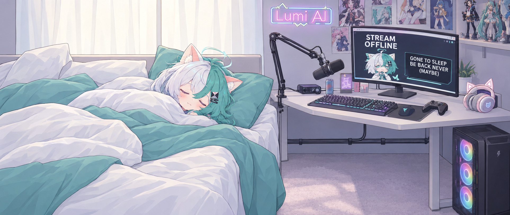
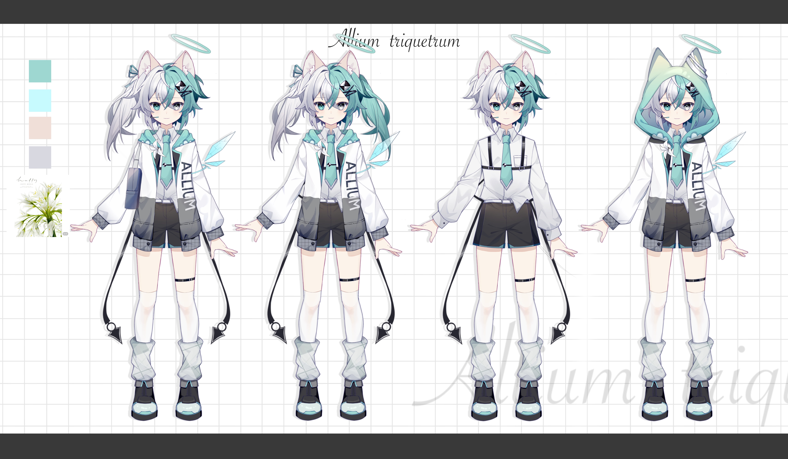

<div align="center">

  

  # Lumi AI Companion

  

  <p><em>A local-first, agentic AI companion running on consumer hardware.</em></p>

  <p>
    <a href="#what-she-does">Features</a> •
    <a href="docs/README.md">Documentation</a> •
    <a href="#installation">Installation</a> •
    <a href="#running">Running</a> •
    <a href="sdk/README.md">SDK</a>
  </p>

</div>

---

> All ten architectural phases are complete. Lumi has a full external SDK,
> Discord voice with DAVE end-to-end encryption handled in pure Python, a
> complete local web client at `127.0.0.1:5000`, file uploads that persist
> into searchable long-term memory, and a full security pass with provenance
> markers, an SDK allowlist, a command allowlist, and a `realpath` file
> sandbox. What's left is tuning against real use.

A local-first, agentic AI companion running on consumer hardware. Lumi is a
persona-driven VTuber-style assistant with real tool use — she can read and
write files, run commands, search the web, control a browser, query her own
memory, verify her own work, track her own behavioral patterns, drive her own
Live2D avatar, and route casual chat through a faster path — all coordinated
through local Ollama.

Unlike scripted chatbots or bracket-tag "tool" syntax, Lumi uses **structured
tool calling** through Ollama's native `/api/chat` tool interface. When she
calls a tool, it actually runs. When she says she did something, you can check
the log and see that she did.

Phase 8 is complete: Lumi has an **external SDK**. Other applications connect
to her over a local websocket, register their own tools, and receive
invocations when she decides to use them — see [`sdk/README.md`](sdk/README.md).

Phase 10 is complete: Lumi has a full **local web client** at
`127.0.0.1:5000` — a first-run setup wizard, chat, dashboard, memory browser,
persona editor, model manager, cloud provider support (OpenAI, Anthropic,
Gemini, Groq, OpenRouter, and other OpenAI-compatible endpoints), an
integrations page, a settings page with password change and session
management, per-user memory and emotional-state isolation, and voice in the
browser. It's all served locally, so the default setup never leaves your
machine. The terminal remains a first-class developer tool; the two surfaces
share the same state and history.

Uploads to the web chat — screenshots, PDFs, documents, text files — are
analyzed at upload time (VLM for images, direct parse for documents), saved
into `data/library/` with a searchable sidecar, and indexed into ChromaDB so
Lumi can reference them in future conversations. Duplicate uploads are
detected by content hash and can be replaced or cancelled from a modal. See
[data/README.md](data/README.md) and [docs/architecture.md](docs/architecture.md)
for the pipeline.

---

## Character Design

<div align="center">
  
</div>

---

## Table of Contents

- [What She Does](#what-she-does)
- [Documentation](#documentation)
- [Requirements](#requirements)
- [Installation](#installation)
- [Running](#running)
- [Roadmap](#roadmap)
- [Credits](#credits)
- [Disclaimer](#disclaimer)

---

## What She Does

- **Real agentic tool use.** Eleven built-in tools (file read/write, shell
  commands, web search, browser control, memory recall, library search, avatar
  control) plus any actions registered by SDK plugins. She picks tools
  herself, chains up to six steps per turn, and reads each result before
  deciding what to do next. File writes and shell commands need your `y/n`
  approval. Agent mode is a plain on/off toggle (`!agent_on` / `!agent_off`).
  See [docs/architecture.md](docs/architecture.md) and
  [docs/security.md](docs/security.md).
- **Persona and voice.** Personality, lore, and rules live in `lumi.yaml` and
  can be edited live from the web client. Speech uses Fish Audio with inline
  emotion tags. See [docs/configuration.md](docs/configuration.md).
- **Memory and inner state.** Timestamped, importance-scored long-term memory
  in ChromaDB, an emotional state with cognitive frames, a self-model of her
  own patterns, and an autonomous heartbeat that lets her speak unprompted.
  See [docs/architecture.md](docs/architecture.md) and
  [modules/README.md](modules/README.md).
- **File uploads.** Screenshots, PDFs, and documents dropped into the web
  chat are analyzed at upload time and indexed into ChromaDB. Lumi can quote
  them, answer questions about them, and reference them days later by content.
  See [data/README.md](data/README.md).
- **Screen awareness.** An ambient sampler and an on-demand multimodal path use
  a local vision model to describe what is on screen.
- **Local first, cloud by choice.** Runs entirely on local Ollama by default.
  The main path and the fast/background path can each be pointed at a local
  model or at OpenAI, Anthropic, Gemini, Groq, OpenRouter, or any
  OpenAI-compatible endpoint, so you decide which work leaves the machine.
  Cloud calls retry on rate limits and server errors and respect
  per-provider quotas. There is no automatic failover. Vision, speech-to-text,
  and embeddings always stay local. See
  [docs/models.md](docs/models.md#local-and-cloud-routing).
- **VTube Studio avatar.** Drives her own Live2D avatar through expressions,
  positions, and emotion-tag triggers. See [modules/README.md](modules/README.md).
- **Discord voice.** Joins voice channels, hears every speaker, and talks back
  with DAVE end-to-end encryption handled in pure Python. See
  [docs/discord-voice.md](docs/discord-voice.md).
- **Local web client.** Setup wizard, chat, dashboard, memory browser, persona
  editor, model manager, integrations, and settings at
  `http://127.0.0.1:5000/`. No framework, no build step.
  - **Chat.** Keeps your scroll position, offers a jump-to-latest button, and
    tints the UI with Lumi's current mood.
  - **Look.** Light and dark themes that apply before first paint and follow
    the OS until you choose, plus a phone layout.
  - **Input.** Keyboard navigation, and hold-to-talk that works with mouse or
    touch and picks a recording format the browser supports (webm, ogg, or
    Safari's mp4).

  See [web/README.md](web/README.md).
- **Diagnostics.** Every module reports to a log hub at
  `http://127.0.0.1:5001/`: secret-scrubbed events, a live dashboard, and a
  persistent `data/logs/events.log`. See
  [docs/architecture.md](docs/architecture.md#diagnostics-telemetry).
- **External SDK.** Third-party apps connect over a local websocket, register
  their own actions, and push context. See [sdk/README.md](sdk/README.md).

### Architecture

Lumi is a single Python process. The parts:

| Part | What it is |
|---|---|
| Shared state | One `signals` object; every input (terminal, mic, Discord, web) appends to `signals.history` |
| Turn engine | The prompter loop, which picks up new messages every 50 ms and calls the model through one `chat_sync()` entry point, local or cloud |
| Background modules | Each on its own thread and event loop: memory, library indexer, heartbeat, emotional state, self-model, ambient perception, Discord, VTube Studio, TTS, SDK server |
| Web server | aiohttp with python-socketio at `127.0.0.1:5000`. The browser polls for chat; socket.io carries TTS audio to tabs that opted in. API errors always come back as JSON |
| Background memory thread | Blocking memory and library work from the web server (ChromaDB queries, indexing, the upload duplicate scan) runs on a dedicated worker, so it never stalls other requests |
| Log hub | A small threaded HTTP server at `127.0.0.1:5001` |

The turn flow, process and thread layout, web server internals, and
telemetry are documented in [docs/architecture.md](docs/architecture.md). For
a file-level map of the backend, see [modules/README.md](modules/README.md).

---

## Documentation

[docs/README.md](docs/README.md) is the full index. The most common entry
points:

| If you need... | Read |
|---|---|
| Model routing, local vs. cloud, providers, and the model manager | [docs/models.md](docs/models.md) |
| How the process, threads, and web server fit together | [docs/architecture.md](docs/architecture.md) |
| Working on the browser UI | [web/README.md](web/README.md) |
| Discord voice details and diagnostics | [docs/discord-voice.md](docs/discord-voice.md) |
| Safety layers and the threat model | [docs/security.md](docs/security.md) |
| What does not work yet | [docs/known-limitations.md](docs/known-limitations.md) |
| Diagnostics, FFmpeg problems, and memory backfill | [docs/troubleshooting.md](docs/troubleshooting.md) |
| What Lumi writes to `data/` | [data/README.md](data/README.md) |

---

## Requirements

- **Python** 3.11+ (Conda recommended for environment isolation)
- **Ollama** running locally with a tool-capable model
- **FFmpeg** on PATH, for Discord voice playback. If voice send is silent, see
  [docs/troubleshooting.md](docs/troubleshooting.md)
- **Playwright Firefox** (`playwright install firefox`)

The remaining Python packages (`discord.py>=2.7`, `davey`, `chromadb`,
`aiohttp`, `python-socketio`, `argon2-cffi`, `pyvts`, `keyboard`, `pyyaml`,
`faster-whisper`, `websockets>=12.0`) install through `pip` in the steps below.
`ruamel.yaml` is optional — install it for comment preservation when editing
the persona. `psutil` and `mss` are only needed for the SDK example clients.

For reproducible installs, use the pinned lock file instead of resolving fresh
versions: `pip install -r requirements.lock.txt`.

---

## Installation

1. **Clone and enter the workspace.**

   ```bash
   git clone https://github.com/SteveJaman/lumi-ai.git Lumi-master
   cd Lumi-master
   ```


2. **Create and activate a Conda environment.** 
   *(If you don't have Conda installed, grab <a href="https://docs.conda.io/en/latest/miniconda.html" target="_blank">Miniconda</a> first).*

   ```bash
   conda create -n lumi python=3.11
   conda activate lumi
   ```

3. **Install dependencies.**

   ```bash
   pip install -r requirements.txt
   pip install aiohttp python-socketio argon2-cffi chromadb
   playwright install firefox
   ```

   If `requirements.txt` already lists these, the second line is redundant.

4. **Create `.env`** at the workspace root:

   ```
   FISH_API_KEY=your_fish_audio_key
   FISH_REFERENCE_ID=your_voice_reference_id
   DISCORD_BOT_TOKEN=your_bot_token
   DISCORD_VOICE_CHANNEL_ID=000000000000000000
   DISCORD_CHANNEL_ID=000000000000000000
   ```

   Cloud provider keys are optional. Set them from the Models page or the
   setup wizard, or add them to `.env` yourself:

   ```
   # ---- Cloud LLM providers ----
   # OPENAI_API_KEY=
   # ANTHROPIC_API_KEY=
   # GEMINI_API_KEY=
   # GROQ_API_KEY=
   # OPENROUTER_API_KEY=
   # Optional base-URL overrides for self-hosted / proxy endpoints:
   # OPENAI_BASE_URL=
   # ANTHROPIC_BASE_URL=
   # GEMINI_BASE_URL=
   # GROQ_BASE_URL=
   # OPENROUTER_BASE_URL=
   ```

   The integration keys are also written by the Integrations page. To change
   her voice, upload a 10-30 second reference clip to Fish Audio and set
   `FISH_REFERENCE_ID` to the new `reference_id`.

5. **Configure `constants.py`.** `WORKSPACE_ROOT` self-locates from the
   file's own path, so you don't need to edit it. Set `LLM_ENDPOINT`,
   `TIMEZONE`, and `OUTPUT_DEVICE_INDEX` for your machine. Run
   `python scripts/check_outputs.py` for output device indices, or
   `python scripts/check_mics.py` for input devices. A full pre-flight is
   available via `python scripts/check_system.py`.

6. **Edit `lumi.yaml`.** This is where Lumi's persona lives: name, host,
   personality, lore, appearance, and dialogue.

7. **Pull the model.** The recommended base is Qwen3 8B via Ollama.

   ```bash
   ollama pull qwen3:8b
   ```

   `MODEL_NAME` and `FAST_MODEL_NAME` in `constants.py` both point at
   `qwen3:8b` — the fast path uses the same weights with thinking disabled.
   Any tool-calling model works. For routing options, cloud providers, and
   lower-end hardware settings, see [docs/models.md](docs/models.md).

8. **VTube Studio (optional but recommended).** Install VTS, load a Live2D
   model, enable the API in VTS settings, then run `python main.py` once to
   trigger the plugin authentication prompt. If your model uses
   keyboard-bound hotkeys, edit `HOTKEY_KEYBINDINGS` in
   `modules/vtubeStudio.py` to match the model's key combos.

---

## Running

```bash
conda activate lumi
python main.py
```

You will be asked to choose audio routing (local PC, Discord voice channel, or
both). Once initialized, the terminal prints:

```
=======================================================
  Lumi AI Ready — Audio routed to: LOCAL
  Mic: active (press \ to toggle mute)
  Web client:  http://127.0.0.1:5000/
  Diagnostics: http://127.0.0.1:5001/
  SDK:         ws://127.0.0.1:5056/ws
=======================================================
```

Three ways to interact:

- **Terminal.** Type at the prompt; `\` toggles mic mute.
- **Microphone.** Just talk; voice activity detection triggers recording.
- **Web client.** Open `http://127.0.0.1:5000/`. First visit goes to the setup
  wizard; after that you land on `/login`, then chat.

All three share the same history. A message typed at the terminal shows up in
the web chat within 1.5 seconds.

### Terminal commands

Type `!list` at any time for the full command card. The most useful ones:

| Command | Effect |
|---|---|
| `!agent_on` / `!agent_off` | Enable or disable agent mode (off by default) |
| `!agent <task>` | One-shot agent turn, returns to the current mode |
| `!state` | Show emotional state, traits, and active cognitive frame |
| `!recall <query>` | Search long-term memory for a topic |
| `!self` | Show self-model observations and session stats |
| `!model` | Show current model routing state |
| `!sleep` | Summarize the session and save continuity state |

### Agent mode example

```
Anthony: !agent_on
Lumi: [agent mode: ON] Agent mode engaged. Tools are live, Anthony.

Anthony: write a script called fib.py that prints the first 10 fibonacci
         numbers, run it, and tell me the actual output

Lumi: Thinking (agent step 1/6)...
[Lumi wants to use tool: write_file({'path': 'fib.py', 'content': '...'})]
  -> Allow this? (y/n): y
  -> Created fib.py (... chars written).

Thinking (agent step 2/6)...
[Lumi wants to use tool: run_command({'command': 'python fib.py'})]
  -> Allow this? (y/n): y
  -> Exit code 0 ...

[confident] There you go. The output is real — I actually ran it.
```

The same turn can be driven from the web chat with the **Agent mode** chip.
Confirmations still happen in the terminal.

### Web client

Everything in the persona, model routing, provider keys, integrations, and
settings can be changed from the browser, including resets of chat history,
session state, self-model, and memory under **Settings, then Advanced**. See
[web/README.md](web/README.md) for the client's structure.

---

## Roadmap

Architectural phases inspired by Neuro-sama (Vedal987). The goal is not
intelligence parity — it's architectural parity. Neuro runs continuously, has
internal state, makes her own decisions, and acts without being prompted.

| Phase | Description | Status |
|---|---|---|
| 1 | Autonomous heartbeat | ✅ Complete |
| 2 | Emotional state + traits + cognitive frames | ✅ Complete |
| 3 | Continuous ambient perception | ✅ Complete |
| 4 | Episodic memory (timestamps + importance) | ✅ Complete |
| 5 | Multi-model orchestration | ✅ Complete |
| 6 | Self-model / meta-cognition | ✅ Complete |
| 6.5 | Avatar control (VTube Studio) | ✅ Complete |
| 7 | Discord voice bridge | ✅ Complete (pure Python, no sidecar) |
| 8 | External SDK (websocket plugin host) | ✅ Complete |
| 9 | Security hardening | ✅ Complete |
| 10 | Local web client | ✅ Complete |

**Phase 7** was completed in pure Python. The C# sidecar originally planned
turned out to be unnecessary once `davey` shipped a Python binding and
`discord.py` 2.7 integrated DAVE for the send path. Voice receive, speaker
attribution, group context, and the diagnostics commands are described under
[docs/discord-voice.md](docs/discord-voice.md).

**Phase 8** is complete. External applications connect to Lumi over a local
websocket on `127.0.0.1:5056`, register their own actions, push context, and
receive invocations, using a wire protocol modeled on Vedal's Neuro SDK. It was
demonstrated end to end with a working Python plugin that captures screenshots
and logs timestamped notes. See [sdk/README.md](sdk/README.md).

**Phase 10** is complete: the local web client, file upload pipeline, per-user
memory and emotional-state isolation, browser voice, and multi-provider LLM
routing all shipped. Uploads are analyzed at intake, saved into
`data/library/` with searchable sidecars, and indexed into ChromaDB for
retrieval on future turns. The remaining security hardening from that pass
(10.17) is tracked under Phase 9.

**Phase 9** is complete. Fourteen hardening items shipped: provenance
markers on external content, a deny-by-default SDK allowlist with per-client
capability ceilings, a command allowlist, a `realpath` file sandbox, protected
paths, secret scrubbing in logs, memory-poisoning guards, Discord rate
limiting, tool-call anomaly detection, a LAN exposure gate, and a pinned
dependency lock file. Encryption at rest is a BitLocker recommendation, not an
in-app feature. Live diagnostics and machine checks are available as offline
harnesses: `scripts/check_system.py` for the environment,
`tests/test_debug.py` for a whole-project health pass, and
`tests/test_all_features.py` for an end-to-end feature pass that includes
the sandbox, shell, provenance, and redaction guards. See
[docs/security.md](docs/security.md) for the threat model and incident
playbook, and [docs/roadmap.md](docs/roadmap.md) for phase status.

---

## Credits

Built as a personal project. Architecture inspired by Neuro-sama
(Vedal987).

* **VTube Model:** [Arii / Ariu (Booth)](https://booth.pm/en/items/5879420)
* **SDK protocol** modeled after Vedal's Neuro SDK (VedalAI/neuro-sdk).
* **Discord voice receive** would not be possible without `davey` by the
  Discord team and the AIRI project's TypeScript implementation, which served
  as the reference architecture.
* **Reference plugin** under [`plugin/plugin.py`](plugin/plugin.py) demonstrates
  the SDK protocol with two actions: a screenshot capture and a timestamped
  note logger.

Built using Ollama, ChromaDB, Faster-Whisper, Fish Audio, Playwright,
pyvts, aiohttp, python-socketio, ruamel.yaml, discord.py, davey, and
pyautogui.

---

## Disclaimer

Local, experimental AI companion project. The language model generates all
responses dynamically; behavior depends on the specific model and its prompt
adherence. This is a personal-use agent, not a production system. Use with
assumption of risk.